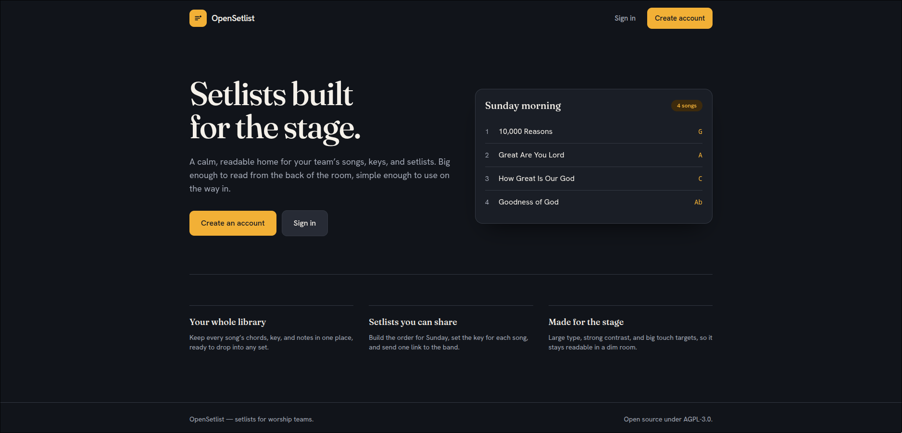

# OpenSetlist

A free, open source setlist builder and music team tool for worship teams. Build a setlist from a
shared song library, share it with the band, and perform from it on stage, online/offline.



- **Frontend:** SvelteKit (installable PWA)
- **Backend:** Rust + Axum
- **Database:** PostgreSQL
- **License:** AGPL-3.0

## Status

Early. Building the MVP: song library and setlist builder.
See `PRD.md` for requirements, `PLAN.md` for the engineering plan, `tasks.md` for the work
breakdown, and `tracker.md` for live progress.

## Development

Requires Rust (1.99+), Node (22+), Docker.

```bash
cp .env.example .env          # then edit secrets
docker compose up -d db       # postgres
# server
cd server && cargo run        # http://localhost:8080/health
# web
cd web && npm install && npm run dev
```

## Self-hosting

```bash
cp .env.example .env
docker compose up -d          # db + server + web on :3000
```

## Contributing

Licensed under AGPL-3.0. By contributing you agree your contributions are licensed the same.
